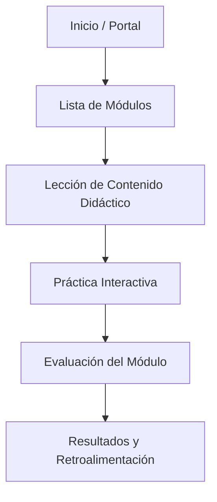
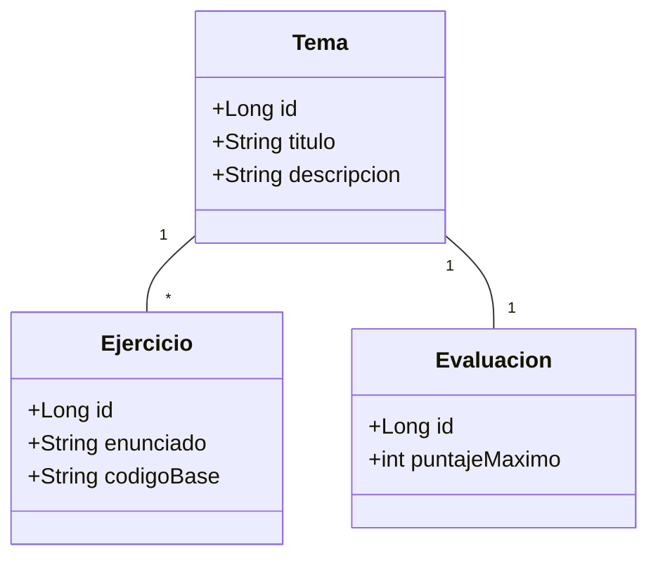

# 📐 Diseño y Arquitectura — AulaLógica Web

## 📑 Contenido

1. [Ficha del problema y usuario objetivo](#1-ficha-del-problema-y-usuario-objetivo)
2. [Historia de usuario modelo](#2-historia-de-usuario-modelo)
3. [Matriz de requisitos](#3-matriz-de-requisitos)
4. [Arquitectura MVC por capas](#4-arquitectura-mvc-por-capas)
5. [Diagrama de navegación y flujo del estudiante](#5-diagrama-de-navegación-y-flujo-del-estudiante)
6. [Diagrama de clases del modelo](#6-diagrama-de-clases-del-modelo)

---

## 1. Ficha del problema y usuario objetivo

| Campo | Descripción |
|-------|-------------|
| **Título del proyecto** | AulaLógica Web — Aplicativo didáctico de fundamentos de programación en Java |
| **Usuario objetivo** | Estudiantes universitarios de primer semestre que inician en lógica de programación |
| **Problema** | Dificultad para visualizar la ejecución de algoritmos y comprender condicionales y ciclos en Java |
| **Solución** | Plataforma web local con Spring Boot que ofrece explicaciones, prácticas interactivas con retroalimentación inmediata y evaluaciones |

---

## 2. Historia de usuario modelo

> *Como* estudiante que inicia en programación, *quiero* resolver un ejercicio de condicionales y recibir una explicación detallada del resultado, *para* comprender por qué se ejecutó una rama específica del programa.

---

## 3. Matriz de requisitos

| ID | Tipo | Descripción | Prioridad |
|----|------|-------------|:---------:|
| **RF-01** | Funcional | Presentar contenidos teóricos y explicaciones didácticas sobre lógica y sintaxis de Java | Alta |
| **RF-02** | Funcional | Permitir la resolución interactiva de ejercicios de condicionales y ciclos con retroalimentación inmediata | Alta |
| **RF-03** | Funcional | Generar evaluaciones diagnósticas y calcular el puntaje obtenido por el estudiante | Media |
| **RNF-01** | No funcional | Desarrollado en Java usando Spring Boot y motor de plantillas Thymeleaf | Alta |
| **RNF-02** | No funcional | Arquitectura modular basada en el patrón MVC (Modelo-Vista-Controlador) | Alta |
| **RNF-03** | No funcional | Interfaz ligera, clara y responsiva para ejecución en entorno local | Media |

---

## 4. Arquitectura MVC por capas

| Capa | Tecnología | Responsabilidad |
|------|------------|-----------------|
| **Vista** (View) | HTML5 + CSS3 + Thymeleaf | Captura las entradas del usuario en formularios y muestra el contenido didáctico y la retroalimentación |
| **Controlador** (Controller) | `@Controller` | Recibe las peticiones HTTP, gestiona las rutas y delega la lógica a la capa de servicio |
| **Servicio** (Service) | `@Service` | Contiene la lógica didáctica, realiza cálculos, aplica validaciones y determina puntajes |
| **Modelo** (Model) | Clases Java | Representa las clases de datos (`Tema`, `Ejercicio`, `Pregunta`, `Resultado`) gestionadas en memoria |

---

## 5. Diagrama de navegación y flujo del estudiante

---

## 6. Diagrama de clases del modelo

