<p align="center">
  
</p>


## 📑 Tabla de contenido

- [Descripción del proyecto](#descripción-del-proyecto)
- [Objetivo general](#objetivo-general)
- [Equipo e integrantes](#equipo-e-integrantes)
- [Tecnologías utilizadas](#tecnologías-utilizadas)
- [Estructura del repositorio](#estructura-del-repositorio)

---

## Descripción del proyecto

**AulaLógica Web** es un aplicativo web educativo diseñado para acompañar a estudiantes universitarios en el aprendizaje de los fundamentos de programación y algoritmos usando **Java** y **Spring Boot**.

## Objetivo general

Diseñar, construir y presentar colaborativamente un aplicativo web didáctico que integre los conocimientos de programación del periodo académico de manera comprensible.

## Equipo e integrantes

| Integrante | Rol |
|------------|-----|
| Esteban Zambrano | Desarrollo Backend |
| Kevin Garcés | Contenidos Didácticos |
| Cristian Gomez | Diseño UI/UX |
| Erick Cordonez | Documentación |

## Tecnologías utilizadas

| Categoría | Tecnología |
|-----------|------------|
| Lenguaje | Java |
| Framework web | Spring Boot (Spring Web, Thymeleaf, Validation) |
| Construcción | Maven |
| Editor | Visual Studio Code |
| Control de versiones | Git & GitHub |

## Estructura del repositorio

```
PROYECTO-AULA-WEB/
│
├── 🖼️ banner.svg
│
├── 📁 docs/                      Documentación, diagramas, historias de usuario y bosquejos
│
├── 📁 src/                       Código fuente de la aplicación Spring Boot
│   ├── 📁 main/java/.../
│   │   ├── 📁 controller/        Controladores MVC
│   │   ├── 📁 service/           Lógica de negocio y validaciones
│   │   └── 📁 model/             Modelos de datos
│   └── 📁 main/resources/
│       ├── 📁 templates/         Vistas Thymeleaf (HTML)
│       └── 📁 static/            Archivos estáticos (CSS/Imágenes)
│
└── 📝 README.md                  Información general del proyecto
```
